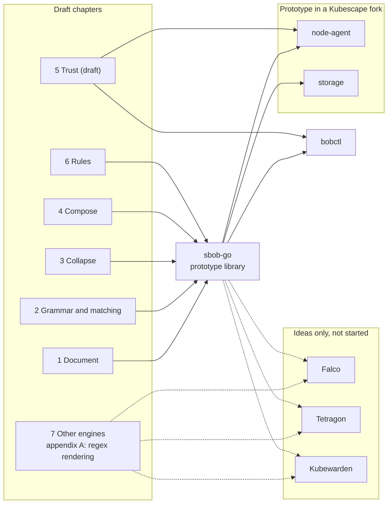

# Software Bill of Behaviour: a proposal

Thank you for taking a look. This repository holds a proposal, and it is very much work in progress. Nothing here is a standard, and nothing here should be read as a finished or working system.

## What we are trying to do

Many good tools observe what a workload does at runtime: which processes it starts, which files it opens, where it connects. Each of them describes that behaviour in its own way, so a profile learned with one tool cannot easily be read by another, and users have to learn every format anew.

We would like to explore whether a shared description of expected behaviour could make runtime profiling feel the same to a user, whichever tool they run. The idea is a behaviour document (a Software Bill of Behaviour) that a tool can learn, a person can review and sign, and any engine can check against, each in its own way.

This is an early draft written in the open, so that the people who build these tools can tell us where it is wrong, where it is unnecessary, and where it gets in their way.

## What is here

- `spec/` holds draft chapters: the behaviour document, the pattern grammar, how learned documents are generalized, how documents are combined, a draft trust model, a rule model, and first thoughts on how other engines could read a document. They use precise wording so the ideas can be discussed and tested, not because they are settled.
- `spec/sbob-v0.0.4.md` is the earlier published draft (version 0.0.4, stage Proposed), kept unchanged as the starting point; each chapter lists what it changes.
- `schema/` holds draft schemas for the behaviour document, the bundle manifest and the alert stream.
- `conventions/conventions.yaml` lists the names the drafts use for keys, values, kinds and rules.

## The picture

The drafts are being tried out in a prototype library, `sbob-go`, and in a fork of the Kubescape node-agent, its storage and the bobctl CLI. These experiments help us find out whether the ideas hold together. They are not a product. How other engines might read a document is only an idea so far; we would very much like to hear from the people who maintain those engines before anything is built.

Solid arrows mark where a chapter is being tried out in the prototype. Dashed arrows are ideas we would like to discuss with each project.

| chapter | what it tries to describe | where it is being tried out |
|---|---|---|
| 1 Document | the behaviour document and its identity | the prototype library (`profile`, `identity`) and the forked storage |
| 2 Grammar | how paths and argument lists are matched | the prototype library (`match`) and the forked node-agent |
| 3 Collapse | how learned behaviour is generalized | the prototype library (`collapse`), the forked storage and bobctl |
| 4 Compose | how several documents combine for one container | the prototype library (`compose`) and the forked node-agent |
| 5 Trust | signed documents and a trust policy (an early draft) | the forked node-agent and bobctl |
| 6 Rules | how detection rules refer to a document | the rule set of the forked node-agent |
| 7 Other engines, appendix A | first thoughts on how another engine could read a document | not tried yet; questions for the engine maintainers |

For other engines, our current thinking is that a rule would not be translated from one rule language into another. Instead, each engine would receive the expected behaviour as data in its own native form, and keep its own way of writing rules. Whether that is practical for each engine is exactly what we hope to learn from their maintainers.

## Roadmap

Alignment with OpenTelemetry is a goal. A chapter on it is on the roadmap: the rules in chapter 6 are written today against the event fields and rule identifiers of the Kubescape node-agent (`R0001` and the others), and we would like them to become semantic rules, named and described in the terms of the OpenTelemetry semantic conventions, so that every tool could report the same behaviour under the same name.

That chapter is not being worked on yet. For now we are trying to settle the schema of the behaviour document itself, and to find out whether, and how, the transpilation in chapter 7 could be useful to every tool in the ecosystem.

## Feedback

Comments, objections and corrections are very welcome, especially from people who maintain runtime-security and observability tools. If a draft misdescribes your project, please tell us; we would rather change the draft than ask anyone to change their tool.
