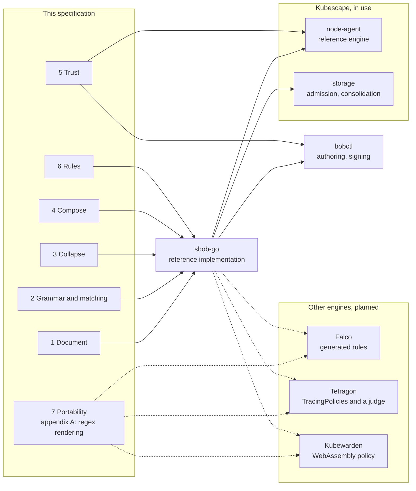

# SBoB specification

The Software Bill of Behaviour specification: the behaviour document, its pattern grammar, matching semantics, composition and trust model, conventions, and the portable rule set.

`spec/sbob-v0.0.4.md` is the published text of version 0.0.4 (stage Proposed), imported verbatim as the seed. Chapters under `spec/` are the normative text and list their changes from the seed; `schema/` holds the behaviour document schema, the bundle manifest schema and the alert stream contract; `conventions/conventions.yaml` is the registry of keys, values, kinds, rule names and rule functions.

This repository holds specification text and schemas only. Conformance is proven against a separate conformance suite; a summary is published here once it is green.

Work in progress: the text is a prototype of the design, and chapters will still change.

## The picture

The specification defines one meaning for a behaviour document. The reference library, `sbob-go`, implements the chapters that decide verdicts, and every engine that reads a document is meant to give the same verdicts as that library. Solid arrows are in use today. Dashed arrows are the intended routes to other engines and do not exist yet.

| chapter | what it fixes | implemented in |
|---|---|---|
| 1 Document | the behaviour document, its legacy form, its identity | `sbob-go` `profile`, `identity`; storage admission |
| 2 Grammar | tokens, path and argument-vector matching, argument expressions | `sbob-go` `match`; every verdict of the node-agent |
| 3 Collapse | how learned documents are generalized | `sbob-go` `collapse`; storage consolidation, bobctl |
| 4 Compose | fragments, stacking, subtract, the projection of one container | `sbob-go` `compose`; node-agent |
| 5 Trust | bundle manifest, signed fragments, verdicts, trust policy | node-agent (verification), bobctl (signing) |
| 6 Rules | rule model, profile functions, rule catalogue, deny-all | node-agent rule set; `sbob-go` `rules` names the catalogue |
| 7 Portability, appendix A | fidelity classes, the projection model for other engines, regular-expression rendering | `sbob-go` `rules` classifies, `match` renders; the engines themselves are planned |

Rules are not translated from their CEL text: another engine receives the document compiled into its own data plus a fixed template per rule (7.3), and a rule whose class has not been checked against the reference engine is reported, not emitted.

